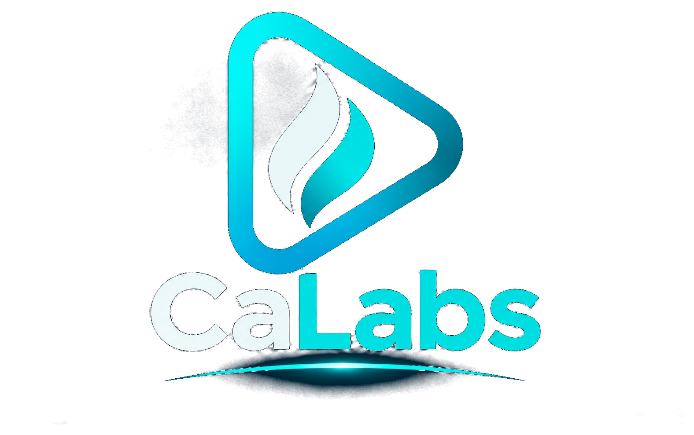
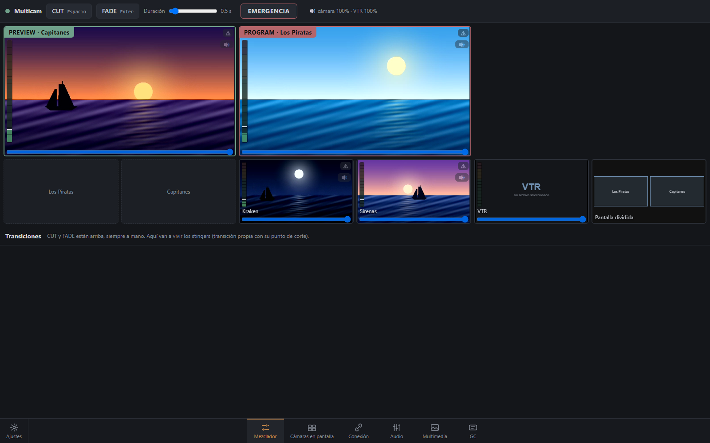
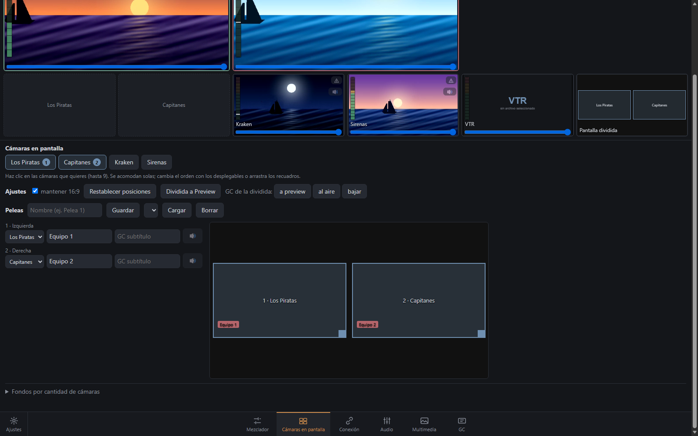
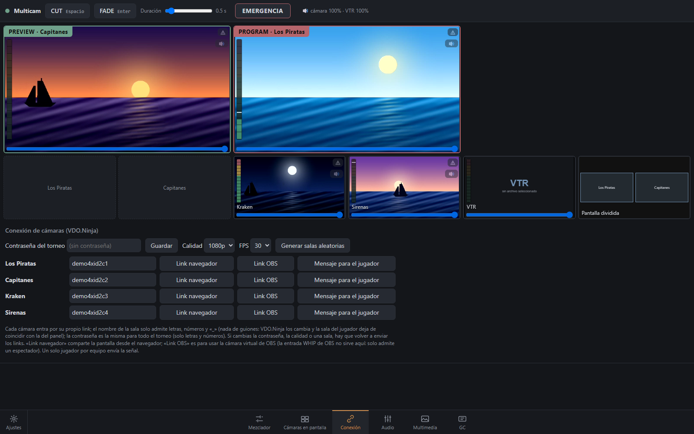
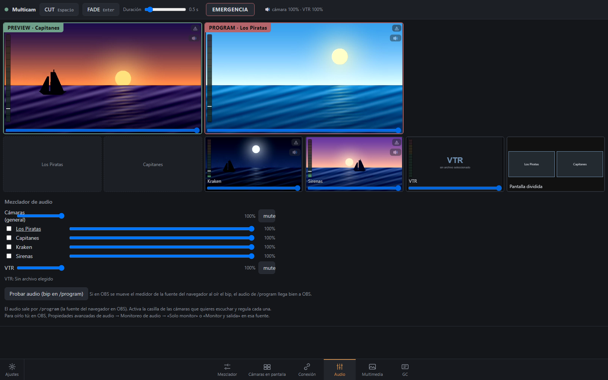
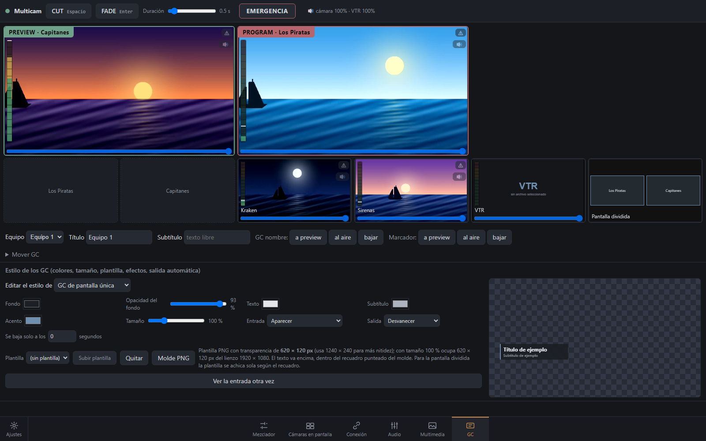

<div align="center">



# 🎛️ CaLabs Switcher Control

**A browser-based multicamera video switcher (vision mixer) for live tournament productions.**
*Un switcher de video multicámara (mezclador de video) que funciona en el navegador, para producciones de torneos en vivo.*

`Beta 0.1 · Node.js + WebRTC (VDO.Ninja) + OBS`

</div>

---

## 🇬🇧 English

CaLabs Switcher Control is a **video production switcher that runs in your browser**. Players send their game from home, you cut between them in a control panel with **Preview and Program** (the classic switcher workflow, in the spirit of hardware mixers), and **OBS** takes one clean 1920×1080 output page to stream or send out over NDI. No capture cards, no video cables, no expensive hardware.

> 🌍 **Language note:** the control panel is currently in **Spanish only**. This README is bilingual; an English interface is on the roadmap.


*Multiview with live audio meters on every source, Preview and Program, and the always-visible EMERGENCY button. (Demo with test sources.)*

### ✨ What it does today
- 🎚️ **Switcher** with Preview / Program, **CUT** and **FADE** (adjustable duration) and keyboard control
- 📺 **Multiview** with a **live audio level meter on every source**, safe-area guides on Preview and a big **EMERGENCY** button that is always one click away
- 🎥 **Cameras over VDO.Ninja (WebRTC):** each player joins with **one link per camera**, from a browser or from OBS's virtual camera. Room names, shared tournament password and 1080p30 are set from the panel
- 🔢 **Show only the cameras you need** (1 to 9; the aerial camera counts as one more), so a small tournament does not need nine windows
- 🧩 **Split screen** for 2 to 9 cameras with backgrounds, a graphic per box, per-box audio and saved "fights"
- 🎨 **On-screen graphics:** names and scoreboard (from Google Sheets) with styles, PNG templates, in/out effects and auto-hide
- 🎬 **VTR media player** for images and videos, **kept in sync** between the panel and the output, with a **countdown timer** (`-02:28 / 03:10`) that blinks red in the last 10 seconds; the emergency can be an image or a video
- 🔊 **Audio mixer** per camera and VTR, master level and a test beep
- 🧭 **Switcher-style layout:** a page bar at the bottom (Switcher, Split screen, Connection, Audio, Media, Graphics) and the multiview always on top
- 🕹️ **Hardware control:** a plugin for **keys and dials** of the macropad, one launcher per command, and a plain HTTP API (`POST /api/do/<command>`) that works even with OBS in front
- 🖥️ **Clean output:** `/program` is a 1920×1080 page that OBS loads as a *Browser Source* (OBS does the NDI)
- 🧪 About **300 automated tests**

| Split screen | Connection | Audio | Graphics |
|:--:|:--:|:--:|:--:|
|  |  |  |  |

### 🧱 How it works

```
 Players (browser or OBS virtual camera)
        │  WebRTC, through VDO.Ninja
        ▼
 ┌──────────────────────────────┐        ┌─────────────────────────────────┐
 │  /control  (operator panel)  │  ───►  │  /program  (clean 1920×1080)    │ ──► OBS Browser Source ──► stream / NDI
 │  multiview · Preview/Program │ state  │  what goes on air               │
 └──────────────────────────────┘        └─────────────────────────────────┘
        ▲
        │  keys and dials (plugin) · keyboard · HTTP API
```

The **state lives in the server** (one small Node.js program), so the panel, the output and the macropad always agree. This program **does not stream by itself**: OBS carries the output out.

### 💿 Run it
Requires **Windows 10/11 (also runs in WSL)**, **[Node.js](https://nodejs.org/) 20+**, **[OBS Studio](https://obsproject.com/)** and Chrome or Edge. For NDI from OBS you also need the DistroAV plugin.

1. Download or clone this repository.
2. Double-click **`start.bat`**. The first time it creates `config/teams.json` from the example and opens it: put your team names. Run it again to start.
3. Open the panel at `http://localhost:3000/control/`.
4. In OBS add a **Browser Source**: URL `http://localhost:3000/program/`, **1920 × 1080**, **30 fps**, and tick *Control audio via OBS*.
5. In the **Connection** tab write a room name for each camera (**letters, numbers and `_` only — no hyphens**, VDO.Ninja changes them and the player would not match), optionally set a password, and send each player their own link.

Other systems: `npm install && npm start`. Tests: `npm test`. The full operating manual (in Spanish) is in [`docs/MANUAL.md`](docs/MANUAL.md).

### 🗺️ Roadmap

**✅ Done**
- [x] ~~🎚️ Switcher with Preview / Program, CUT and adjustable FADE~~
- [x] ~~📺 Multiview with audio meters on every source and safe-area guides on Preview~~
- [x] ~~🎥 Cameras over VDO.Ninja with one link per camera, shared password and 1080p30~~ — *tested end to end with a real player*
- [x] ~~🔢 Choose how many cameras are shown (1 to 9, aerial camera included)~~
- [x] ~~🧩 Split screen for 2 to 9 cameras with backgrounds, per-box graphics and audio, and saved fights~~
- [x] ~~🎨 Graphics with styles, templates, effects and auto-hide, and a scoreboard from Google Sheets~~
- [x] ~~🎬 VTR synced between panel and output, with a countdown and a red warning in the last 10 s~~
- [x] ~~🚨 EMERGENCY button always visible, with an image or video~~
- [x] ~~🔊 Audio mixer per camera and VTR~~
- [x] ~~🧭 Switcher-style page bar at the bottom~~ — first step of the redesign
- [x] ~~🕹️ Macropad control: plugin with keys and dials, per-command launchers and an HTTP API~~ — *tested on the real macropad*
- [x] ~~🔤 Safe room names (no hyphens) and "no room yet" state~~

**🔜 Still to come**
- [ ] 🎞️ **Stinger transitions:** upload your own transparent WebM, choose the exact second where the cut happens (for example 5 s of a 10 s clip) and keep its sound
- [ ] 🚨 Emergency video: **loop on/off**, optional sound and its own upload button
- [ ] 🎛️ Finish the switcher-style redesign, step by step
- [ ] 🧪 **Real-world tests with 8–9 simultaneous players** and a performance measurement
- [ ] 🔊 Calibrate the audio meters with real gameplay and check the levels inside OBS
- [ ] 📊 Try the scoreboard with a real Google Sheet; check GC effects and camera-drop detection live
- [ ] 🔴 Macropad keys that change with the state (for example EMERGENCY lit while it is on)
- [ ] ⏪ Instant replay (the last minutes of each camera) *(idea)*
- [ ] 📱 A QR link to use a phone as the aerial camera
- [ ] 🗑️ Delete uploaded media from the panel
- [ ] 🌐 English interface
> 💡 Ideas or feedback? Open an issue. 🙌

### 🔒 Security and your data

**What the program stores, and where.** Everything stays on your PC and **none of it is part of this repository**:
- `config/teams.json` — your teams and rooms
- `data/split.json` — split-screen layouts, graphic positions and styles, camera names and connection settings (including the tournament password)
- `vtr/` — the media you upload

**How it is protected.** The server listens only on `127.0.0.1` (your own PC) and checks the origin of every WebSocket and API request, so a web page you visit cannot control it. Uploads are limited by type and size, SVG files run sandboxed, and text coming from Google Sheets is always shown as text, never as HTML.

**What it connects to.** VDO.Ninja (the video from your players, peer to peer) and Google Sheets (only if you set up the scoreboard). Nothing is sent to the author. The tournament password travels inside each player's link, so share the links privately.

### 🤖 Built with AI
This project was **designed and directed by Caleb (CaLabs)** and **built with the help of AI**: the code and documentation were written together with **Claude**, an AI assistant made by Anthropic. Features are checked with automated tests and tried by a person on real hardware.

> ✍️ *Co-created with Claude (Anthropic)* 🧡

### ⚖️ Credits and notice
Video transport is provided by **[VDO.Ninja](https://vdo.ninja/)** (by Steve Seguin). This is an independent project, **not affiliated with, endorsed by or sponsored by** Blackmagic Design, Microsoft, the OBS Project, Elgato or VDO.Ninja. ATEM, OBS, NDI and the other names mentioned belong to their owners and are used only to describe compatibility.

---

## 🇨🇱 Español

CaLabs Switcher Control es un **switcher de producción de video que funciona en el navegador**. Los jugadores mandan su juego desde su casa, tú cortas entre ellos en un panel con **Preview y Program** (el flujo clásico de un switcher, al estilo de los mezcladores de hardware), y **OBS** toma una sola página de salida limpia de 1920×1080 para transmitir o sacar por NDI. Sin capturadoras, sin cables de video, sin equipos caros.

> 🌍 **Nota de idioma:** el panel de control está por ahora **solo en español**. Este README es bilingüe; la interfaz en inglés está en la hoja de ruta.


*Multiview con medidores de audio en vivo en cada fuente, Preview y Program, y el botón EMERGENCIA siempre a la vista. (Demostración con fuentes de prueba.)*

### ✨ Qué hace hoy
- 🎚️ **Switcher** con Preview / Program, **CUT** y **FADE** (duración ajustable) y control por teclado
- 📺 **Multiview** con un **medidor de audio en vivo en cada fuente**, guías de zona segura en Preview y un gran botón de **EMERGENCIA** siempre a un clic
- 🎥 **Cámaras por VDO.Ninja (WebRTC):** cada jugador entra con **un link por cámara**, desde el navegador o con la cámara virtual de OBS. Las salas, la contraseña única del torneo y el 1080p30 se ajustan desde el panel
- 🔢 **Muestra solo las cámaras que necesitas** (de 1 a 9; la cámara aérea cuenta como una más), así un torneo chico no necesita nueve ventanas
- 🧩 **Pantalla dividida** de 2 a 9 cámaras con fondos, un gráfico por recuadro, audio por recuadro y "peleas" guardadas
- 🎨 **Gráficas en pantalla:** nombres y marcador (desde Google Sheets) con estilos, plantillas PNG, efectos de entrada y salida y salida automática
- 🎬 **VTR** para imágenes y videos, **sincronizado** entre el panel y la salida, con un **contador** (`-02:28 / 03:10`) que parpadea en rojo en los últimos 10 segundos; la emergencia puede ser una imagen o un video
- 🔊 **Mezclador de audio** por cámara y VTR, nivel general y un bip de prueba
- 🧭 **Diseño estilo switcher:** barra de páginas abajo (Mezclador, Cámaras en pantalla, Conexión, Audio, Multimedia, GC) y el multiview siempre arriba
- 🕹️ **Control por hardware:** un plugin para las **teclas y los diales** del macropad, un lanzador por comando y una API HTTP simple (`POST /api/do/<comando>`) que funciona incluso con OBS al frente
- 🖥️ **Salida limpia:** `/program` es una página de 1920×1080 que OBS carga como *fuente de navegador* (el NDI lo hace OBS)
- 🧪 Cerca de **300 pruebas automáticas**

| Pantalla dividida | Conexión | Audio | Gráficas |
|:--:|:--:|:--:|:--:|
|  |  |  |  |

### 🧱 Cómo funciona
Mismo esquema de arriba: los jugadores mandan su señal por **VDO.Ninja**, el **panel `/control`** es donde cortas, y la **página `/program`** es la salida limpia que **OBS** carga como fuente de navegador. El **estado vive en el servidor** (un programa chico de Node.js), así que el panel, la salida y el macropad siempre coinciden. Este programa **no transmite por sí mismo**: OBS lleva la salida hacia afuera.

### 💿 Cómo usarlo
Necesitas **Windows 10/11 (también corre en WSL)**, **[Node.js](https://nodejs.org/) 20 o superior**, **[OBS Studio](https://obsproject.com/)** y Chrome o Edge. Para NDI desde OBS hace falta además el plugin DistroAV.

1. Descarga o clona este repositorio.
2. Doble clic en **`start.bat`**. La primera vez crea `config/teams.json` desde el ejemplo y lo abre: pon los nombres de tus equipos. Vuelve a abrirlo para arrancar.
3. Abre el panel en `http://localhost:3000/control/`.
4. En OBS agrega una **fuente de navegador**: URL `http://localhost:3000/program/`, **1920 × 1080**, **30 fps**, y marca *Controlar audio mediante OBS*.
5. En la pestaña **Conexión** escribe una sala para cada cámara (**solo letras, números y `_` — nada de guiones**, VDO.Ninja los cambia y el jugador no coincidiría), pon una contraseña si quieres, y mándale a cada jugador su propio link.

En otros sistemas: `npm install && npm start`. Pruebas: `npm test`. El manual de operación completo está en [`docs/MANUAL.md`](docs/MANUAL.md).

### 🗺️ Próximas actualizaciones

**✅ Ya hecho**
- [x] ~~🎚️ Switcher con Preview / Program, CUT y FADE ajustable~~
- [x] ~~📺 Multiview con medidores de audio en cada fuente y guías de zona segura en Preview~~
- [x] ~~🎥 Cámaras por VDO.Ninja con un link por cámara, contraseña única y 1080p30~~ — *probado de punta a punta con un jugador real*
- [x] ~~🔢 Elegir cuántas cámaras se ven (1 a 9, con la aérea incluida)~~
- [x] ~~🧩 Pantalla dividida de 2 a 9 cámaras con fondos, gráficos y audio por recuadro, y peleas guardadas~~
- [x] ~~🎨 Gráficas con estilos, plantillas, efectos y salida automática, y marcador desde Google Sheets~~
- [x] ~~🎬 VTR sincronizado entre el panel y la salida, con contador y aviso rojo en los últimos 10 s~~
- [x] ~~🚨 Botón de EMERGENCIA siempre visible, con imagen o video~~
- [x] ~~🔊 Mezclador de audio por cámara y VTR~~
- [x] ~~🧭 Barra de páginas estilo switcher abajo~~ — primer paso del rediseño
- [x] ~~🕹️ Control por macropad: plugin con teclas y diales, lanzadores por comando y API HTTP~~ — *probado en el macropad real*
- [x] ~~🔤 Salas con nombres seguros (sin guiones) y estado "sin sala"~~

**🔜 Lo que falta**
- [ ] 🎞️ **Transiciones stinger:** subir tu propio WebM con transparencia, elegir el segundo exacto donde ocurre el corte (por ejemplo a los 5 s de un clip de 10 s) y conservar su sonido
- [ ] 🚨 Video de emergencia: **repetir sí/no**, sonido opcional y su propio botón de subida
- [ ] 🎛️ Terminar el rediseño estilo switcher, paso a paso
- [ ] 🧪 **Pruebas reales con 8–9 jugadores a la vez** y medición de rendimiento
- [ ] 🔊 Calibrar los medidores de audio con gameplay real y revisar los niveles dentro de OBS
- [ ] 📊 Probar el marcador con un Google Sheet real; ver los efectos de GC y la detección de cámara caída en vivo
- [ ] 🔴 Teclas del macropad que cambian según el estado (por ejemplo EMERGENCIA encendida mientras está activa)
- [ ] ⏪ Repetición instantánea (los últimos minutos de cada cámara) *(idea)*
- [ ] 📱 Un link con QR para usar un celular como cámara aérea
- [ ] 🗑️ Borrar archivos subidos desde el panel
- [ ] 🌐 Interfaz en inglés
> 💡 ¿Ideas o comentarios? Abre un issue. 🙌

### 🔒 Seguridad y tus datos

**Qué guarda el programa y dónde.** Todo queda en tu PC y **nada de esto forma parte de este repositorio**:
- `config/teams.json` — tus equipos y salas
- `data/split.json` — diseños de pantalla dividida, posiciones y estilos de gráficas, nombres de cámaras y ajustes de conexión (incluida la contraseña del torneo)
- `vtr/` — los archivos que subes

**Cómo se protege.** El servidor escucha solo en `127.0.0.1` (tu propio PC) y revisa el origen de cada petición WebSocket y de la API, así que una página web que visites no puede controlarlo. Las subidas se limitan por tipo y tamaño, los SVG corren aislados y los textos que vienen de Google Sheets siempre se muestran como texto, nunca como HTML.

**A qué se conecta.** VDO.Ninja (el video de tus jugadores, de punto a punto) y Google Sheets (solo si configuras el marcador). No se envía nada al autor. La contraseña del torneo viaja dentro del link de cada jugador, así que comparte los links en privado.

### 🤖 Creado con IA
Este proyecto fue **diseñado y dirigido por Caleb (CaLabs)** y **creado con ayuda de inteligencia artificial**: el código y la documentación se escribieron junto a **Claude**, un asistente de IA de Anthropic. Las funciones se comprueban con pruebas automáticas y las prueba una persona en equipos reales.

> ✍️ *Co-creado con Claude (Anthropic)* 🧡

### ⚖️ Créditos y aviso
El transporte de video lo hace **[VDO.Ninja](https://vdo.ninja/)** (de Steve Seguin). Este es un proyecto independiente, **sin afiliación, respaldo ni patrocinio** de Blackmagic Design, Microsoft, el proyecto OBS, Elgato ni VDO.Ninja. ATEM, OBS, NDI y los demás nombres mencionados pertenecen a sus dueños y se usan solo para describir compatibilidad.

---

<div align="center">

Made with 💙 and 🤖 AI by **CaLabs** · All rights reserved © CaLabs · *Todos los derechos reservados*

</div>
